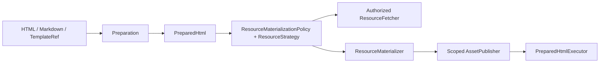

# 资源管线

`parse_html` 固化 `DocumentBase` 与结构快照；后续阶段不得重新解析 markup 推导base。`ResourceFetcher` 在 fetch/cache hit 前执行本地与网络授权。`ResourceMaterializationPolicy` 是单次调用覆盖，`ResourceStrategy` 是 Provider
composition transport；两者都不把 locator 与 payload 混为一谈。

远程 HTTP(S) 授权同时检查主机名与最终连接地址。`allow_hosts` 为空时不限制主机名，非空时只允许列出的主机及子域；两类情况都不能绕过 IP 策略。回环、RFC 1918、链路本地、CGNAT/shared `100.64.0.0/10`、ULA 等非公网解析地址必须匹配 `allow_private_networks` 中的显式 IP/CIDR，`deny_hosts` 优先。受管理的 Playwright HTML rendering 只把 HTTP(S) `GET` 请求送入这一策略与 pinned transport；WebSocket、非 `GET` 请求和 service worker 会被拒绝。原生 `lease_page()` / `lease_browser()` 的调用方保留导航和后续请求的所有权。

`LocalAccessPolicy` 在本地 fetch、模板与 Provider path 使用前完成授权，`ExecutionLeaseProvider` 则让 Provider/native lease 进入同一 startup/drain 边界。

caller 通过 `ResourceAccess.fetch*()` 从 `ResourceRef` 得到 `ResourceContent`，或通过 `publish()` 在显式 lease 内得到 `PublishedResource`。Provider 的收窄接口暴露同名的 `fetch()`，并额外暴露 `fetch_published()` 来读取租约内的发布 capability。publication 的 URL 与精确请求头作为一个原子值传播；`fetch_published()` 不会缓存这项授权。请求头只适用于原 URL，redirect 到不同 URL 时不会被转发，同 host 的其他路径也不继承授权。

HTTP fetch 发生 redirect 时，`ResourceContent.final_url` 保留已通过策略检查的最终 URL；没有 redirect 时为 `None`。所有 redirect 都在 guarded Bot fetch 内完成，不交回浏览器直接跟随。重定向 CSS 的相对引用按 `final_url` 解析；重定向 `text/html` 与 `application/xhtml+xml` 当前会被拒绝，因为缺少安全的 document base。JavaScript、模块与 XML 的相对 URL 语义不做转换。

远程浏览器通常使用 memory route 或 filehost。选择 filehost 时 composition 显式创建 aiohttp server/store，并把同一 store 注入 publisher。one-shot `RuntimePlan`中的 server/store 与唯一 runtime 同寿命；service cleanup 等待活跃 operation 与publication lease 后再关闭。

filehost 在上传完成后先协调当前仍有效的 publication lease，再唤醒等待者；上传过程中已释放的 lease 不会重新占用容量。清空 URL 缓存不会撤销其他调用仍持有的 lease，缓存命中时的续租与释放也按同一顺序串行处理。

所有 fetch、template、publication 与 Provider operation 经过同一个 runtime
admission gate：cleanup 开始后拒绝新操作，已获准操作完成后才释放 cache 与 native
handle。composition 通过 `WorkerExecutor` 隔离阻塞 I/O/native work。
