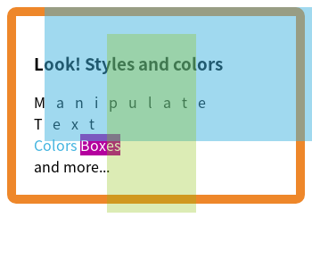
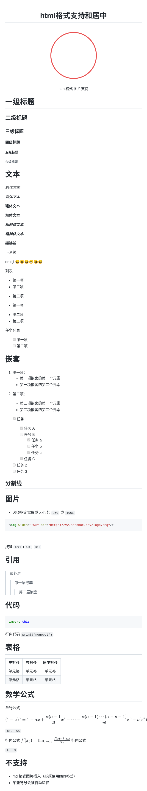
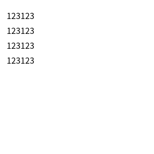

# 渲染 HTML、Markdown 与文本

`HtmlRenderer` 提供了一组统一的异步接口，可以把 HTML、Markdown、纯文本或 Jinja2 模板直接渲染成图片。无论底层配置的是 Takumi 还是 Playwright，调用方式都保持一致。

## 基础渲染

```python
from entari_plugin_htmlrender import HtmlRenderer, RasterOptions, RenderedImage


async def render_examples(renderer: HtmlRenderer) -> tuple[RenderedImage, ...]:
    options = RasterOptions(width=720) # (1)!

    html_img = await renderer.rasterize_html(
        "<main><h1>Hello</h1><p>来自 HTML 的内容</p></main>",
        raster=options,
    )
    md_img = await renderer.rasterize_markdown(
        "# 标题\n\n支持 **加粗**、列表与代码高亮。",
        raster=options,
    )
    text_img = await renderer.rasterize_text(
        "这是一段纯文本，适合直接输出日志或不可信用户输入。",
        raster=options,
    )
    return html_img, md_img, text_img
```

1. 常用渲染参数集中在 `RasterOptions` 中，可以在多次调用之间复用。

### 渲染效果预览

=== "HTML"

    

=== "Markdown"

    

=== "纯文本"

    

## 控制输出尺寸与格式：`RasterOptions`

`RasterOptions` 用来指定图片的宽度、高度、清晰度与编码格式：

| 参数 | 类型 | 默认值 | 说明 |
| --- | --- | --- | --- |
| `width` | `int` | `800` | 视口逻辑宽度（像素） |
| `height` | `int \| None` | `None` | 视口高度；为 `None` 时自动按内容高度撑开（受 `html.max_auto_height` 限制） |
| `device_pixel_ratio` | `float` | `2.0` | 设备像素比（清晰度倍率，默认 2 倍高清图，受 `html.max_device_pixel_ratio` 限制） |
| `format` | `"png" \| "jpeg"` | `"png"` | 输出图片格式 |
| `quality` | `int \| None` | `None` | 压缩质量（`0..100`），仅在 `format="jpeg"` 时有效 |

```python
# 输出 900px 宽、1 倍率、质量 85 的 JPEG 图片
jpeg_options = RasterOptions(
    width=900,
    device_pixel_ratio=1.0,
    format="jpeg",
    quality=85,
)
```

## 读取渲染结果：`RenderedImage`

所有渲染方法都返回不可变的 `RenderedImage` 对象：

- `bytes(image)` 或 `image.data`：获取图片原始字节流，可直接交给消息平台发送或写入文件。
- `image.width`、`image.height`：根据图片文件头解析出的真实像素宽高。
- `image.format`、`image.media_type`：格式（`"png"` / `"jpeg"`）及对应 MIME 类型（`"image/png"` / `"image/jpeg"`）。

## Markdown 使用说明

### 传入字符串 vs 传入文件或远程资源

`rasterize_markdown(source, ...)` 的第一个参数区分类型：

- 传入 `str` 时，**永远视为内联 Markdown 文本**，不会尝试当作文件路径去读。
- 如果要渲染本地文件、包内资源或远程 Markdown，请显式传入 `ResourceRef`（如 `FileResourceRef`、`PackageResourceRef`、`RemoteResourceRef`）。

!!! warning "不可信内容的安全提醒"
    Markdown 解析默认保留原始 HTML 标签，**不会自动清理 XSS 或恶意标签**。渲染用户或模型生成的不可信文本时，请先按业务规则做 HTML 净化；如果只需要纯文字展示，直接使用 `rasterize_text()` 更安全。

### 数学公式与引擎差异

插件内置 `pymdownx.arithmatex(generic=True, smart_dollar=True)` 支持 LaTeX 数学公式：

- **行内公式**：使用紧贴内容的 `$x$` 或 `\(x\)`。两端带空格的 `$ x $` 会保持为普通文本。
- **块级公式**：`$$...$$`、`\[...\]` 或独立的 `\begin{env}...\end{env}` 必须独占段落。行内混写的 `before $$x$$ after` 不会按块级公式解析。
- **代码块豁免**：行内代码与围栏代码块中的 `$` 不会被当作公式。

!!! note "Takumi 暂不支持 Markdown 数学公式"
    含数学公式的 Markdown 在准备阶段会注入 KaTeX 初始化脚本并标记 `DocumentRequirement.JAVASCRIPT`：

    - **Playwright**：正常执行 KaTeX 完成公式排版（且只渲染解析器生成的 `.arithmatex[data-htmlrender-arithmatex]` 容器）。
    - **Takumi**：因为不执行 JavaScript，会直接抛出 `UnsupportedDocumentFeatureError`。若必须使用 Takumi 展示公式，请提前把公式预渲染为静态 HTML 或 SVG。

## 进阶：将「内容准备」与「图片渲染」拆开

如果你希望先检查文档元数据（例如是否依赖 JavaScript、包含了哪些样式与资源），或者把同一份准备好的内容多次渲染成不同尺寸，可以先用 `HtmlPreparer` 生成中立的 `PreparedHtml`，再交给 `HtmlRenderer.rasterize_prepared()`：

```python
from entari_plugin_htmlrender import HtmlPreparer, HtmlRenderer, RasterOptions


async def prepare_then_render(
    preparation: HtmlPreparer,
    renderer: HtmlRenderer,
):
    prepared = await preparation.prepare_markdown("# 一次准备，多次渲染") # (1)!

    mobile = await renderer.rasterize_prepared(
        prepared,
        raster=RasterOptions(width=420),
    )
    desktop = await renderer.rasterize_prepared(
        prepared,
        raster=RasterOptions(width=960),
    )
    return mobile, desktop
```

1. `PreparedHtml` 是不可变的值对象，与具体渲染引擎无关；不过 `HtmlPreparer` 和 `HtmlRenderer` 本身仍绑定当前插件生命周期，不要缓存在全局变量里。

如果手头已经是一段完整 HTML 字符串，且不需要读取任何外部模板或文件，也可以使用同步函数 `parse_html(html, base_url=...)` 直接构造 `PreparedHtml`。
