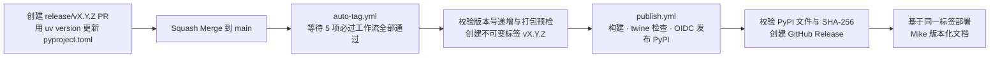

# 发布流程、文档版本与仓库治理

本页面向仓库维护者，说明发版流水线、多版本文档发布方式以及分支治理规则。

## 自动化发布流程

项目采用 Pre-1.0 单调递增的 PEP 440 版本号，完整发版由 GitHub Actions 自动串行衔接：



### 本地预演与打包验证

发版前如需在本地验证 Wheel / Sdist 内容与隔离安装：

```bash
make build-artifacts # 执行 uv build --no-sources、twine check 与 verify_distribution.py
```

如需手动向 TestPyPI 预演，在 GitHub Actions 中手动触发 `publish-test.yml`。

!!! danger "标签不可变原则"
    已经发布到 PyPI 的 `v*` 标签**绝对不要移动或删除**。如发现线上问题，请发布新的递增补丁版本。

---

## 文档构建与版本管理

文档站点使用 **Zensical**（`zensical>=0.1.1`，配置文件为 `mkdocs.yml`）构建，并开启内置 `llmstxt` 插件自动生成 `llms.txt`、`llms-full.txt` 与每页 Markdown；Mermaid (`11.16.0`) 采用本地自托管。

多版本文档由 **Mike** 部署到 `gh-pages` 分支：

- **正式版本**：位于 `/<version>/`，同时按 PEP 440 比较结果决定是否更新 `latest` 别名（补发旧版本维护文档时不会把 `latest` 回退到旧版）。
- **并发保护**：发布脚本通过重新拉取 `gh-pages`、非强制推送与有限次冲突重试来避免覆盖。
- **PR 预览**：部署在 `/pr-preview/pr-<NUMBER>/`，不写入 Mike 版本索引，PR 关闭后自动清理。
- **本地命令**：`make docs-deploy VERSION=0.2.0`（本地部署测试）、`make docs-list`（查看已部署版本）。

---

## 仓库治理与分支保护

仓库在 `.github/rulesets/protect-main.json` 中定义了 `main` 分支的目标保护规则（线性提交历史、仅 Squash Merge、至少 1 位非作者维护者审批、推送重置旧审批、解决全部对话、5 项必过状态检查、禁止强推与删除）。

!!! warning "远端 Ruleset 同步提醒"
    仓库内的 `.github/rulesets/protect-main.json` 只是规则定义文件，**不会**自动同步到 GitHub 远端设置。在确认 GitHub 仓库已启用对应 Ruleset 并完成核验前，维护者合并 PR 时需人工确认各项检查与审批状态。
