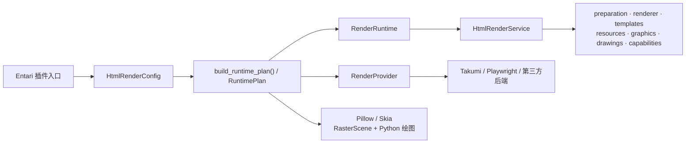

# 架构与运行原理

本页帮助进阶开发者理解插件的内部结构、资源流转方式以及在 Entari 之外独立嵌入的方法。

## 分层架构

插件将「对外业务接口」「核心渲染管线」「具体后端适配」与「Entari 集成」清晰解耦：核心层（`preparation`、`rendering`、`resources`、`graphics`、`runtime`）完全不导入 Entari。



- **业务接口层**：普通插件只需要依赖 `HtmlRenderer`、`HtmlPreparer`、`TemplateRenderer`、`ResourceAccess`、`GraphicsRenderer`、`DrawingRenderer` 等接口，无需关心底层是哪个引擎。
- **组装层（`composition`）**：`build_runtime_plan()` 负责解析配置、选择单个 HTML 后端并确定资源策略，此阶段不发起任何网络或进程 I/O。`RuntimePlan` 是一次性对象，`build_runtime()` 只能调用一次（第二次调用会抛出 `InvalidRenderInputError`）。
- **运行时层（`RenderRuntime`）**：统一管理并发准入、`OPEN` / `CLOSING` / `CLOSED` 状态机以及所有子服务的有序释放。

## 资源处理管线

无论是 HTML、Markdown 还是 Jinja2 模板，进入渲染引擎前都会经过统一的准备与资源安全管线：


- `parse_html` 是唯一的 HTML 标记解析入口。
- 本地文件校验在每次读取时都会解析符号链接后的真实路径；远程请求在每一跳重定向都会同时核对域名与 DNS 解析后的 IP。

## Entari 生命周期与热重载

在 Entari 中，插件的运行由 Launart 的三个标准阶段驱动：

1. **`preparing`（启动阶段）**：若启用了 Filehost，先启动独立的 aiohttp 服务（即使 `startup: off` 也会启动）；随后按 `startup` 策略执行 `warmup` 或 `probe`。若此处失败，已创建的资源会回滚，该代服务标记为失败。
2. **`blocking`（运行阶段）**：正常接收来自各业务插件的渲染与绘图请求。
3. **`cleanup`（关闭阶段）**：将运行时切为 `CLOSING`，拒收新请求并等待在途任务和租约排空，再按顺序关闭绘图、HTML Provider、模板、资源、远程连接与 Filehost（若中途被取消或失败，支持重试并通过 `ExceptionGroup` 聚合错误）。

### 热重载的两个阶段

Entari 热重载 `htmlrender` 时分为两个明确的事务边界：

- **切换前（暂存阶段）**：重新导入模块、校验配置、解析 Provider、构建新运行时并校验 Python 绘图入口。**如果此处失败，旧插件保持原样继续对外服务**，不会中断线上业务。
- **切换后（生效阶段）**：销毁旧服务、提升新插件，并进入新实例的 `preparing` 阶段（绑定 Filehost、执行 `warmup` / `probe`）。如果此处失败，旧实例不会自动回滚，需要修复后手动再次重载。

对于 `disable` → `enable`：正常禁用并清理完成后，插件会排队一个延迟重建的占位实例，在下次启用进入 `preparing` 时重新构建运行时（不重新读取磁盘配置）。

---

## 高级：脱离 Entari 独立嵌入

如果你希望在其他异步框架或独立脚本中使用本插件，可以直接调用 `entari_plugin_htmlrender.composition.build_runtime_plan()`：

```python
from entari_plugin_htmlrender import RasterOptions
from entari_plugin_htmlrender.composition import build_runtime_plan
from entari_plugin_htmlrender.config import HtmlRenderConfig


async def standalone_render() -> bytes:
    config = HtmlRenderConfig(provider="takumi")
    plan = build_runtime_plan(config) # (1)!
    runtime = plan.build_runtime()    # (2)!

    hosted_server = plan.hosted_asset_server
    if hosted_server is not None:
        await hosted_server.startup()
    try:
        await runtime.startup()
        image = await runtime.renderer.rasterize_markdown(
            "# Standalone",
            raster=RasterOptions(width=640),
        )
        return bytes(image)
    finally:
        await runtime.aclose()
        if hosted_server is not None:
            await hosted_server.aclose()
```

1. 测试或定制集成时，可传入仅关键字参数 `provider_override=my_provider` 注入自定义后端。
2. 宿主必须自行负责启动和关闭顺序：如果存在 `plan.hosted_asset_server`，先启动它再启动 `runtime`；关闭时先关闭 `runtime` 再关闭 `hosted_asset_server`。

!!! note "独立模式下的 Python 绘图差异"
    在独立模式（无 Entari 宿主）下，`graphics.drawings` 为每个绘图项使用独立的私有模块命名空间并在首次 `render()` 时延迟加载；`reload: true` 仅追踪入口文件及同包相对导入，不跨绘图项同步共享模块。
